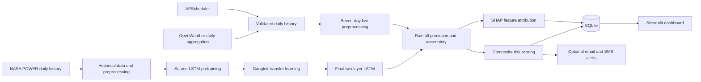

# CloudBurst AI

CloudBurst AI is a Python research and monitoring application for next-day rainfall prediction and configurable cloudburst risk assessment. It combines a daily-weather sequence model, a Streamlit dashboard, a SQLite history store, and optional email and SMS alerts.

## Project Status

This repository contains a research prototype and local monitoring workflow. It is not a certified forecasting or emergency-warning service. No public REST API is implemented; the weather API module makes outbound requests to OpenWeather. The live pipeline is configured for one target location per process, defaulting to Gangtok.

## Problem Statement

The project aims to use recent weather history and current daily observations to estimate next-day rainfall and summarize related risk factors. Its intended users are researchers and operators reviewing weather conditions across Himalayan locations. Predictions and risk scores require independent validation before operational or emergency use.

## Features

- NASA POWER historical weather ingestion for model development.
- OpenWeather One Call 3.0 daily aggregation for live weather input.
- Seven-day, twelve-feature input sequences for next-day rainfall prediction.
- Source-location pretraining and Gangtok transfer learning.
- Monte Carlo dropout estimates for prediction uncertainty.
- Configurable composite risk scoring using rainfall, humidity, wind speed, and season.
- SHAP GradientExplainer attributions for the rainfall model output.
- Streamlit dashboard backed by SQLite prediction, risk, and alert history.
- Optional SMTP email and Twilio SMS alerts.
- APScheduler-based recurring pipeline execution.

## Architecture



The implementation is organized as follows:

- `dashboard/`: Streamlit UI.
- `api/`: outbound weather-provider integration.
- `pipeline/`, `prediction/`, `risk_engine/`, `explainability/`: live inference workflow.
- `database/`, `alerts/`, `scheduler/`: persistence, notifications, and recurring execution.
- `training/`, `transfer_learning/`, `utils/`: historical-data processing and model development.
- `data/`, `models/`, `outputs/`: input data, model artifacts, and generated results.

The dashboard and pipeline currently share one Python codebase. There is no separate JavaScript frontend or inbound application API.

## Technologies

- Python 3.11 recommended for the current dependency set.
- TensorFlow/Keras, NumPy, pandas, and scikit-learn.
- SHAP, Matplotlib, Seaborn, and Plotly.
- Streamlit, Requests, APScheduler, and SQLite.
- SMTP for email and Twilio for optional SMS delivery.

Install Python dependencies from `requirements.txt`. This project does not have `package.json` or Node.js frontend dependencies.

## Dataset and Data Sources

Historical daily observations are obtained from the NASA POWER point API. `dataset.py` requests maximum and minimum temperature, relative humidity, wind speed, and corrected precipitation for Dehradun, Shimla, Manali, Mussoorie, and Gangtok. The downloader's configured date range is 2015-01-01 through 2025-12-31.

Live observations use OpenWeather One Call 3.0 Daily Aggregation. The pipeline expects daily precipitation totals; a current-weather interval such as one-hour rainfall is not an equivalent model input. Live daily history is stored in SQLite. The inference preprocessing currently seeds that history from `outputs/v2_corrected_experiment/v2_corrected_processed_dataset.csv`, which is therefore retained by the Git ignore rules.

The raw and intermediate training datasets are not committed by default. To retrain from a fresh checkout, obtain the NASA POWER data and place the combined dataset at `data/raw/combined_weather_dataset.csv`, which is the Phase 1 loader's expected input path.

## Machine Learning Approach

The model predicts next-day rainfall from a sequence of seven daily rows with twelve selected features: location encoding, scaled temperature, humidity, wind and rainfall values, rainfall lags and rolling means, season, and day of year. Live preprocessing combines six contiguous prior daily records with the current daily observation.

### LSTM Architecture

The selected model has an input shape of `(7, 12)`, followed by an LSTM layer with 64 units and sequence output, dropout, a 32-unit LSTM layer, dropout, and a one-unit dense rainfall output. The experiment configuration uses a dropout rate of 0.2. The final model contract is checked by `utils/final_model_guard.py` before inference.

### Transfer Learning

The transfer workflow pretrains on Dehradun, Shimla, Manali, and Mussoorie, then adapts the model to Gangtok. The final transfer step loads the source-pretrained two-layer LSTM, freezes the 64-unit LSTM layer, and fine-tunes the remaining trainable layers on Gangtok adaptation data. Training and evaluation arrays are experiment artifacts, not required for inference.

### SHAP Explainability

Live explanations use SHAP `GradientExplainer` with up to 50 background samples drawn from Gangtok rows in the processed historical dataset. Feature contributions are summarized over the seven time steps and describe attribution to the rainfall model output. They are not causal explanations and do not independently validate the risk score.

### Risk Prediction

The risk engine combines rainfall, humidity, wind speed, and seasonal components using weights stored in `models/risk_config.json` (0.50, 0.25, 0.15, and 0.10 respectively). Its configured score boundaries are 35, 60, and 80 on a 0-100 scale. These are configurable heuristic settings, not calibrated probabilities of a cloudburst.

## API and Command Usage

There is no inbound HTTP API. `api/weather_api.py` calls the external OpenWeather endpoint; `dataset.py` downloads NASA POWER data. The command-line entry point is `main.py`:

```powershell
python main.py --dashboard
python main.py --run-pipeline
python main.py --scheduler
```

Run the dashboard and scheduler in separate terminals when both are needed. The scheduler runs a pipeline once at startup, then repeats at the configured interval. Bare `python main.py` runs the Phase 1 training pipeline, not the dashboard.

The weather integration defaults to no synthetic fallback. If live API access is missing or fails, the live pipeline reports that weather is unavailable; it does not replace provider data with synthetic weather. The OpenWeather daily endpoint requires access to One Call 3.0 daily aggregation.

For the free public demo, start the dashboard and select **Run Historical Demo**. It uses the seven latest contiguous, already-engineered Gangtok rows in `outputs/v2_corrected_experiment/v2_corrected_processed_dataset.csv`, runs the final trained model, and labels the output as a historical next-day demonstration. It requires no OpenWeather key and never presents synthetic values as live weather. **Fetch Live Weather** is a separate optional action; without a configured key or successful daily access, it reports that live weather is unavailable and leaves the historical demo available. `USE_MOCK_DATA=True` is an explicit synthetic test mode and is visibly labeled as synthetic.

## Local Setup

Create and activate a virtual environment, then install dependencies:

```powershell
python -m venv .venv
.\.venv\Scripts\Activate.ps1
python -m pip install --upgrade pip
python -m pip install -r requirements.txt
```

On macOS or Linux, activate with `source .venv/bin/activate` instead. For a fresh checkout, copy `.env.example` to `.env` and keep the `.env` file local. The example lists credential variable names with empty values; ordinary non-secret settings can be omitted to use the defaults below. Do not overwrite an existing `.env` containing local credentials.

Start the dashboard:

```powershell
python main.py --dashboard
```

By default Streamlit listens on port 8501. Open `http://localhost:8501` in a browser. To run predictions, start `python main.py --scheduler` in another terminal or run the one-shot pipeline command above.

The Phase 1 training command requires the historical combined CSV at `data/raw/combined_weather_dataset.csv`. The free Historical Demo requires the final model artifacts and processed dataset listed above, which are included in the deployment bundle.

## Environment Variables

Credential names are listed in `.env.example`; never put real values in that file or commit `.env`.

| Variable | Purpose | Default or requirement |
| --- | --- | --- |
| `OPENWEATHER_API_KEY` | OpenWeather credential | Required for live weather; not required in mock mode |
| `USE_MOCK_DATA` | Explicitly use synthetic test observations instead of OpenWeather | `False`; synthetic mode is not live or historical |
| `TARGET_LOCATION` | Target location name | `Gangtok` |
| `TARGET_LAT`, `TARGET_LON` | Target coordinates used by mock/current-weather code | `27.3389`, `88.6065` |
| `DB_PATH` | SQLite database location | `database/cloudburst_predictions.db` |
| `ENABLE_EMAIL` | Enable SMTP alerts | `False` |
| `SMTP_HOST`, `SMTP_PORT` | SMTP server configuration | `smtp.gmail.com`, `587` |
| `SMTP_USER`, `SMTP_PASSWORD` | SMTP sender credentials | Required when email is enabled |
| `ALERT_RECIPIENT_EMAIL` | Email destination | Required when email is enabled |
| `ENABLE_SMS` | Enable Twilio alerts | `False` |
| `TWILIO_ACCOUNT_SID`, `TWILIO_AUTH_TOKEN` | Twilio credentials | Required when SMS is enabled |
| `TWILIO_FROM_NUMBER`, `ALERT_RECIPIENT_PHONE` | Twilio sender and destination numbers | Required when SMS is enabled |
| `ALERT_THRESHOLD` | Minimum alert risk level | `HIGH` |
| `SCHEDULER_INTERVAL_MINUTES` | Scheduled pipeline interval | `30` |
| `DASHBOARD_PORT` | Streamlit dashboard port | `8501` |

## Deployment

No Dockerfile, process manifest, or cloud-provider deployment configuration is included. For a small demonstration, deploy one instance with persistent storage and run the dashboard and scheduler as separate supervised processes. Keep the SQLite database on durable storage and ensure the model and seed dataset are included.

For a production service, deploy the dashboard and scheduled worker separately, use a shared managed database, store credentials in the hosting platform's secret manager, and package or version the model and historical seed data. The current database layer is SQLite-specific, so a shared database deployment requires a database-adapter change. Ensure only one scheduled worker runs unless duplicate pipeline jobs are prevented.

The `.gitignore` keeps raw/intermediate datasets, training outputs, local databases, secrets, and alternate experiment models out of Git. It explicitly allows the final inference model, scaler, and processed-history CSV currently required by live inference. If these artifacts are moved to artifact storage or Git LFS, update the deployment process and ignore exceptions together.

## Limitations

- This is a prototype, not a certified disaster-warning system. Do not use it as the sole basis for public safety decisions.
- The live pipeline processes one target location per configured process; multi-location orchestration is not implemented as a single service workflow.
- The historical demo replays the latest packaged contiguous Gangtok observations; it is not a current forecast. The live pipeline requires OpenWeather One Call 3.0 access and contiguous daily history. Synthetic mock observations are for testing only and are not validated real-world weather.
- Composite risk thresholds and weights are configurable heuristics and should be calibrated and independently reviewed.
- SHAP values describe model-output attribution, not causality or certainty.
- SQLite is suitable for local or single-instance use, not concurrent multi-replica production deployment on ephemeral storage.
- Retraining requires historical datasets and generates large intermediate arrays and experiment artifacts that are intentionally excluded from Git.